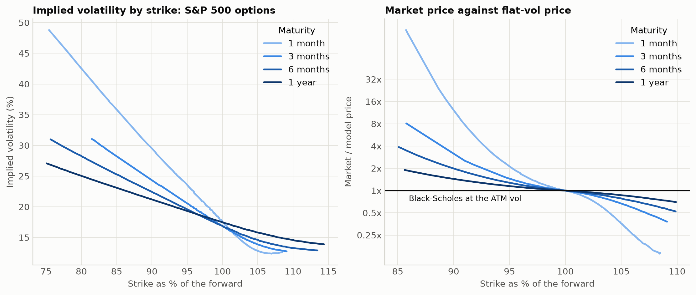
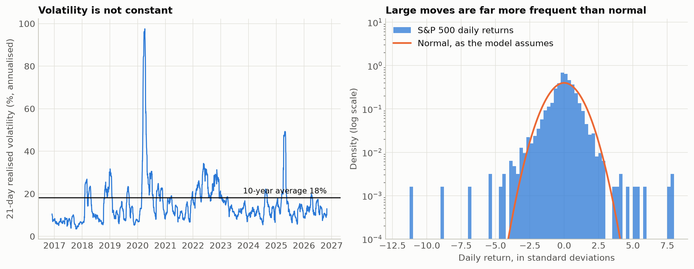
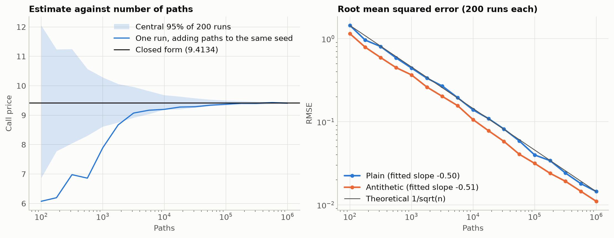

# bs-options-lab

A from-scratch implementation of the Black-Scholes model, tested against real S&P 500 option quotes to find out where it holds and where it breaks.

## Objective

Black-Scholes prices an option from a single unknown: volatility. If the model were literally true, one volatility would price every option on an underlying. This project builds the model and its numerical methods, verifies them, then tests that claim on market data.

No pricing library is used. Everything is implemented with numpy, and `scipy.stats.norm` provides the normal distribution.

## Key results

Market figures come from one snapshot of `^SPX` options taken on 2026-10-30 at 18:44 UTC, a day the index fell 2.36%. All numbers can be reproduced from `notebooks/analysis.ipynb`.

**1. The constant-volatility assumption fails, by a wide margin.** At 1 month, implied vol runs from about 13% at the 108% strike to about 30% at the 90% strike. The skew is at least 3.7 vol points at every maturity, against a median bid-ask width of 0.11, so it is not noise.



| Maturity | At-the-money vol | Vol at 90% strike | Skew (vol points) | Market / flat-vol price, 90% put |
|---|---|---|---|---|
| 1 month | 17.6% | 29.5% | 11.9 | 12.4x |
| 3 months | 16.9% | 24.3% | 7.5 | 2.5x (91% strike) |
| 6 months | 16.9% | 22.4% | 5.6 | 2.0x |
| 1 year | 17.5% | 21.2% | 3.7 | 1.4x |

A 1-month put 10% out of the money would be worth 2.65 index points at the at-the-money vol. Multiples overstate the gap, because far-from-the-money prices are very convex in vol, so the vol points are the fairer comparison.

**2. History contradicts the same assumptions.** Over 10 years of daily S&P 500 returns there were 17 moves beyond 4 standard deviations, where a normal distribution predicts 0.16. The 21-day realised vol ranged from 3% to 98%.



**3. Free market data needs real cleaning before it can be used.**

- 92% of live quotes had a last trade price outside the current bid-ask, so the pipeline uses bid and ask only.
- Yahoo's implied vol column disagrees between the call and the put at the same strike by a median of 4.64 vol points near the money. The vols computed here differ by 0.04.
- Put-call parity flagged 88 strikes. Their typical miss was +142 to +174 index points on a day the index fell 183, which fits quotes left over from before the fall. One of them would have put a false spike in the smile.

**4. The numerical methods agree with the closed form.** Monte Carlo error falls at a fitted rate of n^-0.501 (theory: n^-0.5), and reaches 0.15% of the price at 1,000,000 paths.



## Model assumptions

Black-Scholes assumes that:

- the stock follows a geometric Brownian motion, so log-returns are normal with constant volatility, and prices have no jumps;
- the interest rate and dividend yield are constant;
- trading is continuous and free, so an option can be hedged perfectly at all times;
- options are European.

The last two give the model its central idea. If an option can be replicated by trading the stock, its price cannot depend on the stock's expected return. That is why volatility is the only unknown.

## Methods

| Step | File | Approach | Check |
|---|---|---|---|
| Pricing | `pricing.py` | Closed form with a dividend yield | Put-call parity, published values, T→0 and σ→0 limits |
| Greeks | `greeks.py` | Closed forms for delta, gamma, vega, theta, rho | Finite differences and the Black-Scholes PDE |
| Monte Carlo | `montecarlo.py` | Exact terminal sampling of the GBM, optional antithetic draws | Error rate and confidence interval coverage |
| Implied vol | `implied_vol.py` | Newton-Raphson on vega, falling back on bisection | Round trips on a grid of 5,520 options |
| Market data | `market_data.py` | Yahoo or Bloomberg CSV, forward from parity, out-of-the-money quotes only | Synthetic chains with known answers |
| American options | `binomial.py` | Cox-Ross-Rubinstein tree | Convergence to the closed form |

Three choices matter most:

- **S&P 500 options** are European, so they match the model's exercise style. American exercise would otherwise leak into the implied vol: on the tree, the early-exercise premium of a 1-year at-the-money put is 9.3% of its price at a 5% rate and zero at a 0% rate.
- **The forward comes from put-call parity,** not from the quoted spot. A delayed spot would not line up with the option quotes, and this also removes the need for a rate or dividend input.
- **The bisection fallback earns its place.** It handled 16.4% of the test grid, where vega is too flat for Newton-Raphson. The largest repricing error across the 5,450 solvable options was 8.4e-10.

## Limitations

Each assumption, and what this project measured about it:

| Assumption | Measured here | Consequence |
|---|---|---|
| **One volatility per underlying** | Skew of 3.7 to 11.9 vol points | The model cannot price different strikes consistently. In practice it is used as a quoting convention, with a different vol per strike and maturity. |
| **Constant volatility over time** | 21-day realised vol from 3% to 98% | A single vol input hides a large source of risk, and a vega hedge is needed on top of a delta hedge. |
| **No jumps** | 17 moves beyond 4 standard deviations against 0.16 expected; worst day -11.2 standard deviations | Continuous delta hedging cannot protect against a gap, which is consistent with the premium on out-of-the-money puts. |
| **Constant rate** | Implied rates of 4.48% to 5.15% across maturities | Small effect here: adding 1 point to the rate moves near-the-money vol by 0.01 vol points at 1 month and 0.15 at 1 year, because the forward is observed directly. |
| **Constant dividend yield** | Implied yield of 0.76% to 0.99% from 3 months to 1 year, 2.08% at 1 month | The short-dated figure is unreliable: it depends on a delayed spot. Real dividends are discrete, which a continuous yield only approximates. |

The evidence itself has limits:

- **One snapshot, on a stressed day.** The skew may be steeper than usual, and nothing here shows how it behaves over time.
- **Delayed quotes.** Yahoo gives no exact time for each quote. The parity check removes the stale quotes it can detect, but it cannot show that the rest are simultaneous.
- **Implied rates are not Treasury rates.** The 3-month implied rate is 52 bp above the 13-week T-bill yield of 3.97%. This is probably a funding spread, which this project did not test. The short-dated rate is also noisy.
- **Crash risk is an interpretation.** The data shows the skew exists, but it does not separate crash risk from demand for hedging.
- **The Bloomberg loader is untested on a real export.** It was tested only on synthetic files.

## Installation

Requires Python 3.11 or later. Developed and tested on Python 3.13.

```bash
git clone <repository-url>
cd bs-options-lab
python3 -m venv .venv
source .venv/bin/activate
pip install -r requirements.txt
```

Reproduce all results and figures. This reads the saved snapshot in `data/` and needs no network access:

```bash
jupyter nbconvert --to notebook --execute --inplace notebooks/analysis.ipynb
```

## Running the tests

```bash
pytest
```

The 147 tests run in a few seconds, on synthetic data, with no network access.

## Using your own data

```python
from bs_lab.market_data import build_smile, fetch_option_chain, load_bloomberg_csv, save_chain

# Fresh quotes from Yahoo. Save them, because a chain cannot be downloaded again later.
quotes = fetch_option_chain("^SPX")
save_chain(quotes, "data/spx_options_new.csv")

# Or a Bloomberg export with one row per contract.
quotes = load_bloomberg_csv("data/bloomberg/spx.csv", quote_time="2026-10-30 15:00")

smile = build_smile(quotes)
```

Columns are matched on common Bloomberg names. Pass `column_map={"Your Header": "strike"}` for anything else. Keep exports in `data/bloomberg/`, which git ignores, because Bloomberg data is licensed.

Run these from a Python session in the repository root with `src` on the path, for example `PYTHONPATH=src python`.

## Possible improvements

- **Collect snapshots over time,** on calm and stressed days, to see how the skew moves. This would address the largest weakness above.
- **Fit a model of the smile,** such as SVI for a single expiry or Heston for stochastic volatility, then check whether it removes the mispricing.
- **Simulate delta hedging** to measure the profit and loss when volatility or jumps depart from the model.
- **Use Bloomberg data** to compare timestamped quotes with the Yahoo results.
- **Extend to American underlyings** by using the tree to back out implied vols on single stocks.
